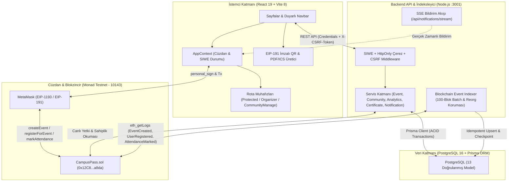

# CampusPass — Sistem Mimarisi ve Güvenlik Sınırları (Architecture Guide)

**CampusPass**, zincir üstü doğrulanabilirlik (Monad Testnet akıllı sözleşmesi) ile zincir dışı operasyonel zenginliği (PostgreSQL, Prisma ORM, SIWE oturumları ve gerçek zamanlı SSE bildirimleri) birleştiren hibrit bir Web3 mimarisi üzerine inşa edilmiştir.

---

## 1. Yüksek Seviye Sistem Mimarisi (Mermaid)

---

## 2. Katmanlar Arası İlişkiler ve Veri Akışı

### 2.1. Ön Yüz (Frontend — React 19 & React Router v7)
- **Kod Bölümleme (`src/routes/AppRoutes.jsx`):** Tüm sayfa bileşenleri `React.lazy()` ile ayrıştırılmıştır. `vendor-ethers` ve `vendor-react` paketleri bağımsız öbekler olarak derlenir.
- **Merkezi Durum (`src/context/AppContext.jsx`):** Cüzdan adresini, ağ kimliğini (`10143`), SIWE oturum durumunu (`authenticated`, `csrfToken`), okunmamış bildirim sayacını ve SSE bağlantısını yönetir. Cüzdan değiştiğinde (`accountsChanged`) veya başka bir sekmede oturum kapatıldığında (`campuspass_auth_event`) tüm kullanıcıya özel önbelleği (`studentProfileCache`) temizler.
- **Performans & Önbellek (`src/utils/studentProfile.js`):** Öğrenci panelinde blokzincir okumaları sınırlı eşzamanlılık (`runBoundedConcurrency`) ve cüzdan adresine göre izole edilmiş 30 saniyelik TTL önbelleği ile yürütülür.

### 2.2. Akıllı Sözleşme (`contracts/CampusPass.sol`) ve Event Indexer
- **Zincir Üstü Çekirdek:** Etkinlik kimliği, başlık, kontenjan, organizatör adresi, öğrenci kaydı (`isRegistered`) ve yoklama onayı (`isAttended`) değiştirilemez biçimde Monad Testnet üzerindeki sözleşmede tutulur.
- **Reorg Korumalı İndeksleyici (`server/src/indexer/eventIndexer.js`):**
  - Monad RPC sınırlarına uygun olarak blokları en fazla `100` blokluk paketler halinde (`INDEXER_BATCH_SIZE=100`) tarar.
  - `IndexerCheckpoint` modeli ile son işlenen bloğu kaydeder; `reorgLookbackBlocks` penceresinde olası zincir yeniden düzenlemelerini (reorg) tespit edip geçersizleşen kayıtları temizler.

### 2.3. Backend Servisleri ve PostgreSQL (13 Prisma Modeli)
`server/prisma/schema.prisma` içindeki 13 model şunlardır:
1. **`Community` & `CommunityMember`:** Üniversite toplulukları, roller (`OWNER`, `ADMIN`, `MEMBER`), başvuru durumları (`PENDING`, `ACTIVE`, `REJECTED`, `REMOVED`) ve Faz 19 denetim izi alanları (`reviewedByWallet`, `reviewedAt`).
2. **`EventMetadata`:** Etkinlik açıklaması, kategorisi, topluluk bağı (`communityId`), başlangıç/bitiş/son kayıt zamanları (TSİ), kampüs/bina/salon bilgisi ve iptal durumu.
3. **`IndexedRegistration` & `IndexedAttendance`:** Zincir üstü kayıt ve yoklama olaylarının indekslenmiş karşılıkları; yoklama tablosunda doğrulayıcı cüzdan (`verifiedByWallet`) denetim alanı.
4. **`IndexerCheckpoint`:** İndeksleyicinin son blok durumu.
5. **`AuthNonce` & `OrganizerSession`:** SIWE tek kullanımlık atomik nonce tablosu ve `sessionTokenHash` + `csrfToken` oturum kayıtları.
6. **`AttendanceCertificate`:** `CP-CERT-V1` dijital katılım sertifikaları, öğrenci profil adı anlık görüntüsü (`displayName` snapshot), `certificateHash` ve `integritySignature`.
7. **`StudentProfile`:** Öğrenci tam adı (`displayName`), üniversite, bölüm, biyografi, avatar ve gizlilik (`isPublic`) ayarı.
8. **`Notification`, `Announcement` & `NotificationPreference`:** Kullanıcı bildirimleri (`dedupKey` korumalı), topluluk/etkinlik duyuruları ve kategori bazlı bildirim tercihleri.

### 2.4. Dinamik QR Yoklama ve 4 Katmanlı Sertifika Motoru
1. **EIP-191 İmzalı QR Bilet (`src/utils/qrVerification.js`):** Öğrenci cüzdanı `CPQR1` protokolüyle etkinlik kimliği, öğrenci adresi, üretim zamanı, son geçerlilik süresi (`180 sn TTL`) ve rastgele nonce içeren yükü imzalar.
2. **Yoklama Doğrulama (`POST /api/events/:eventId/attendance/verify`):** Sunucu imzayı, süreyi, tek kullanımlık nonce'u, öğrencinin kendi QR'ını okutmadığını (**self-scan engeli**) ve doğrulayıcının yetkisini kontrol eder; `verifiedByWallet` denetim izini kaydeder.
3. **4 Katmanlı Sertifika Doğrulama (`GET /api/certificates/:certificateId/verify`):**
   - **Katman 1:** Veritabanı kayıt varlığı ve `ACTIVE` durumu.
   - **Katman 2:** `CP-CERT-V1` SHA-256 + HMAC-SHA256 kriptografik bütünlük mühürü.
   - **Katman 3:** `IndexedAttendance` log kaydı ve indeksleyici senkronizasyon kontrolü.
   - **Katman 4:** Canlı Monad Testnet sözleşmesi üzerinde `checkAttendance` doğrulaması.

---

## 3. Güvenlik Sınırları (Security Boundaries)

| Güvenlik Alanı | Uygulanan Koruma Mekanizması |
|---|---|
| **Kimlik Doğrulama (SIWE)** | EIP-4361 standart mesaj doğrulaması, domain/URI/chainId eşleşmesi, atomik nonce tüketimi (`consumedAt`). |
| **Oturum & CSRF** | Oturum jetonu veritabanında SHA-256 hash (`sessionTokenHash`) olarak saklanır; istemciye `HttpOnly; SameSite=Lax` çerez verilir. Tüm `POST`/`PATCH`/`DELETE` isteklerinde `X-CSRF-Token` başlığı zorunludur. |
| **Rol Tabanlı Yetkilendirme (RBAC)** | İstemci taraflı muhafızlara (`Guards`) ek olarak her hassas sunucu işleminde Prisma ve canlı blokzincir üzerinden sahiplik/rol (`OWNER`/`ADMIN`) doğrulanır. |
| **Kendi Kendine Yoklama (Self-Scan)** | Hem istemci doğrulayıcısında hem sunucu `verifyQrAndAttendance` servisinde `verifierWallet === participantAddress` kesin olarak reddedilir. |
| **Sertifika İsim Sahteciliği** | İstek gövdesinden gelen isimler sertifikaya yazılmaz; yalnızca sunucudaki doğrulanmış `StudentProfile.displayName` değeri anlık görüntü (*snapshot*) olarak mühürlenir. |
| **CSV & XSS Enjeksiyonu** | Tüm metin girdileri Zod şemaları ve HTML/kontrol karakteri temizleyicisiyle doğrulanır; CSV dışa aktarımında `=`, `+`, `-`, `@` ile başlayan hücreler formül enjeksiyonuna karşı nötralize edilir. |
| **Cüzdanlar Arası İzolasyon** | Oturum, profil önbelleği, bildirimler ve sertifikalar cüzdan adresine göre tamamen izoledir; cüzdan değişiminde bellekteki tüm veriler sıfırlanır. |

---

## 4. Bilinen Sınırlamalar (Known Limitations)

1. **Genel Testnet RPC Sınırları:** Monad Testnet genel RPC uç noktası (`https://testnet-rpc.monad.xyz`) saniyede 15 istek ve `eth_getLogs` başına 100 blok sınırına sahiptir. Yüksek yoğunlukta üstel geri çekilme (`callWithRetry`) devreye girer.
2. **Geçmiş Denetim Kayıtları:** Faz 19 öncesinde oluşturulmuş üyelik ve yoklama kayıtlarında aktör sütunları boş (`null`) olduğundan, sistem sahte geçmiş uydurmaz ve `"kayıt yok"` değerini gösterir.
3. **Fiziksel Kamera ve Eklenti Etkileşimi:** Kamera ile canlı QR tarama ve MetaMask tarayıcı eklentisi açılır pencereleri fiziksel tarayıcı ortamı gerektirir.
